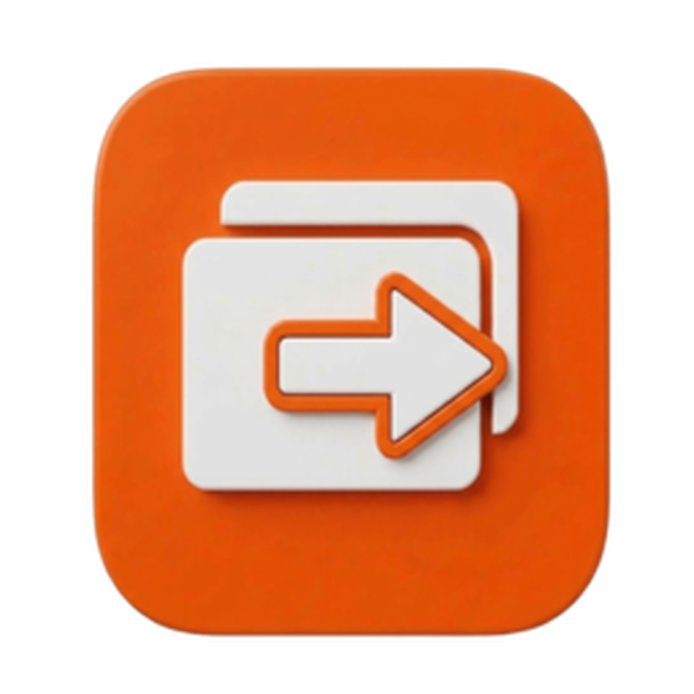

# Zlide



*(Antes se llamaba Slide Remote.)*

Cambia las diapositivas de tu presentación con los **botones de volumen del teléfono** y ve tus **notas del presentador** en la pantalla del teléfono.

Es un solo proyecto de Flutter que se compila en dos papeles:

| Dónde | Papel |
|---|---|
| **Android y iPhone** | Control remoto: botones de volumen, botones en pantalla y notas |
| **Windows, macOS y Linux** | Receptor (“app de escritorio”): presiona AvPág/RePág en la PC y le manda las notas al teléfono |

---

## Contenido

1. [Qué puede hacer](#qué-puede-hacer)
2. [Modos de conexión](#modos-de-conexión)
3. [Uso](#uso)
4. [Notas del presentador](#notas-del-presentador)
5. [Empezar rápido: compilar en Linux, Mac o Windows](#empezar-rápido-compilar-en-linux-mac-o-windows)
6. [Instalación manual (lo que hacen los scripts)](#instalación-manual-lo-que-hacen-los-scripts)
7. [Preparar el proyecto](#preparar-el-proyecto)
8. [Compilar e instalar / crear instaladores](#compilar-e-instalar--crear-instaladores)
9. [Compilar en GitHub (todos los sistemas a la vez)](#compilar-en-github-todos-los-sistemas-a-la-vez)
10. [Convertidor a PDF en Android (LibreOffice)](#convertidor-a-pdf-en-android-libreoffice)
11. [Permisos y red](#permisos-y-red)
12. [Limitaciones](#limitaciones)
13. [Solución de problemas](#solución-de-problemas)
14. [Estructura del proyecto](#estructura-del-proyecto)
15. [Licencias](#licencias)

---

## Qué puede hacer

- **Volumen + / Volumen −** = siguiente / anterior (se puede invertir). También hay botones grandes en pantalla.
- **Tres modos:** Bluetooth, WiFi y Navegador (ver abajo). Al salir de la app suelta el volumen y la conexión; al volver se **reconecta sola**.
- **Notas del presentador** en el teléfono, con título de la diapositiva, aviso de animaciones y “Sigue: …”. Botón para **expandir las notas** a casi toda la pantalla (los botones de cambiar diapositiva se hacen compactos).
- **Proyectar desde la app de escritorio (modo “Transmitir desde PC”), con dibujo:** en la app de escritorio elige tu presentación y toca **Proyectar en esta PC** (o toca ✎ en el teléfono y luego *Proyectar en la PC*). Se abre en el navegador de la PC (presiona *Pantalla completa*) y se controla desde el teléfono: cambias de diapositiva sin simular teclas, las notas van sincronizadas con la página exacta y lo que dibujas en el teléfono (pluma, marcatextos, láser) aparece encima al instante. Funciona igual en Windows, macOS y Linux (también con Wayland), sin permisos especiales. Si guardas cambios en la presentación mientras se transmite, se vuelve a convertir y el navegador y el teléfono se actualizan solos, en la misma diapositiva y sin perder los dibujos. Para .pptx/.odp/.ppt hace falta LibreOffice en la PC (en Windows también sirve PowerPoint); un PDF se proyecta tal cual.
- **Varias pantallas sincronizadas (modo “Transmitir desde móvil”):** el teléfono lleva la diapositiva actual; todos los navegadores abiertos en la dirección muestran siempre la misma. Si alguien cambia de diapositiva con el teclado o el mouse en una de ellas, el cambio pasa por el teléfono y se replica en todas (y en las notas).
- **Cronómetro** de la presentación, solo visible en el teléfono (arriba a la derecha): toca para iniciar o pausar; en pausa aparece ↺ para reiniciarlo. Sigue contando aunque salgas de la app o bloquees el teléfono.
- **Dibujar sobre la diapositiva (modo “Transmitir desde móvil”):** el teléfono muestra la diapositiva actual y lo que dibujes —pluma, marcatextos o puntero láser, en varios colores y **cuatro grosores** (fino, normal, grueso, muy grueso; cada herramienta recuerda el suyo)— aparece al instante sobre la presentación en el navegador de la PC. Los dibujos se quedan en cada diapositiva hasta que los borres; se puede girar el teléfono para dibujar más grande.
- **Por WiFi, las notas llegan desde la PC:** la presentación solo tiene que estar en la computadora.
- **Modo “Transmitir desde móvil”:** el teléfono proyecta la presentación en el navegador de la PC, sin instalar nada en ella, y **convierte .pptx/.odp/.ppt a PDF dentro del teléfono**, sin internet.
- Lee notas de **PowerPoint, LibreOffice, OnlyOffice, WPS, Google Slides exportado** (`.pptx`, `.odp` y variantes).
- La pantalla del teléfono no se apaga mientras la app está abierta.
- **Tema claro y oscuro** con acento naranja: sigue el del sistema; se cambia en **Ajustes → Tema** del teléfono o con el botón ☀/☾ de la app de escritorio.
- **Español e inglés:** usa el idioma del sistema (si no es español, inglés). Se cambia en **Ajustes → Idioma** del teléfono o con el botón de idioma (🌐) de la app de escritorio. La página del modo “Transmitir desde móvil” usa el idioma de la app del teléfono.

## Modos de conexión

En la app los modos se llaman **Control Bluetooth**, **Transmitir desde PC** (por WiFi, con la app de escritorio) y **Transmitir desde móvil** (la página que sirve el teléfono). Abajo, “WiFi” y “Navegador” se refieren a los dos últimos.

| Teléfono → | **Control Bluetooth** | **Transmitir desde PC** (WiFi) | **Transmitir desde móvil** (navegador) |
|---|---|---|---|
| **Android** | ✅ Sin instalar nada en la PC: el teléfono es un **teclado Bluetooth** | App de escritorio | ✅ Sin instalar nada en la PC |
| **iPhone** | App de escritorio (Bluetooth LE) | App de escritorio | ✅ Sin instalar nada en la PC |
| Notas en el teléfono | Elige el archivo en el teléfono | **Desde la PC** (o desde el teléfono) | Del mismo archivo que proyectas |
| Sincronía de notas | Cuenta pulsaciones | Cuenta pulsaciones | Exacta |

- **Bluetooth (Android):** la PC empareja el teléfono como teclado y recibe AvPág/RePág. Sirve con PowerPoint, Keynote, Impress, Google Slides, visores de PDF… en Windows, Mac, Linux, **y también en tablets Android y iPad** (cualquier equipo que acepte un teclado Bluetooth).
- **Bluetooth (iPhone):** iOS no deja que una app sea teclado Bluetooth; el iPhone anuncia un servicio Bluetooth LE y la app de escritorio se conecta sola.
- **WiFi:** la app de escritorio se anuncia en la red (mDNS/Bonjour) y el teléfono la encuentra sin escribir IPs. Si la red bloquea mDNS, se agrega por IP.
- **Navegador:** el teléfono sirve una página web; en la PC (o en una **tablet**) abres la dirección que muestra la app, por ejemplo `192.168.1.23:8080`, y ahí se proyecta. Se puede elegir PDF, `.pptx`, `.ppsx`, `.odp`, `.ppt` (y `.key` en iPhone).

### Presentar desde una tablet

En una tablet (Android o iPad) no se puede instalar el receptor: los sistemas no permiten que una app presione teclas en otra. Usa:

- **Teléfono Android en modo Bluetooth:** la tablet lo ve como teclado Bluetooth.
- **Modo “Transmitir desde móvil”:** abre la dirección del teléfono en Safari/Chrome de la tablet.

## Uso

1. Abre la app en el teléfono y elige el modo.
2. **Bluetooth Android:** “Emparejar nueva” → en la PC, Configuración → Bluetooth → agregar dispositivo → elige el teléfono. Las siguientes veces solo “Conectar” (o se conecta sola al abrir la app).
3. **Bluetooth iPhone / WiFi:** abre la app de escritorio en la PC (puede quedar minimizada), pon tu presentación al frente y en el teléfono elige tu PC.
4. **Navegador:** “Elegir presentación” → abre en la PC la dirección que aparece → “Pantalla completa”. Para dibujar o señalar: **Dibujar sobre la diapositiva**.
5. **Ajustes** (icono arriba a la derecha): invertir botones, usar flechas ← → en vez de AvPág/RePág, tamaño de letra de las notas.

## Notas del presentador

| Modo | De dónde salen |
|---|---|
| **WiFi** | En la app de escritorio, recuadro **“Notas en el teléfono” → Elegir presentación**. Llegan solas al teléfono; si guardas cambios en el archivo se actualizan sin perder la diapositiva actual. La app de escritorio recuerda el archivo. |
| **Navegador** | Del mismo archivo que eliges para proyectar. |
| **Bluetooth** (o WiFi sin archivo en la PC) | **Ver notas del presentador** en el teléfono y eliges el archivo ahí. |

- **Botón ⤢** (esquina del recuadro de notas): las notas ocupan casi toda la pantalla y los botones se hacen compactos. Se regresa con el mismo botón o con “atrás”.
- **Sincronía:** en Navegador es exacta. En Bluetooth y WiFi el teléfono **cuenta las pulsaciones**, incluidas las animaciones “al hacer clic” (igual que PowerPoint). Si se desfasa —por ejemplo, si cambiaste de diapositiva con el mouse— corrígelo con **− / +** en el panel (no mueve nada en la PC).
- **Cada modo tiene sus propias notas:** las que eliges en “Control Bluetooth” no aparecen en “Transmitir desde móvil”, y viceversa. En “Transmitir desde PC” mandan las de la app de escritorio (si no hay, las que elijas en el teléfono para ese modo).
- Las diapositivas ocultas se saltan.

**Formatos con notas**

| Formato | Programas | Teléfono | App de escritorio |
|---|---|---|---|
| `.pptx` `.ppsx` | PowerPoint, OnlyOffice, WPS, Google Slides, Keynote (exportado) | ✅ | ✅ |
| `.pptm` `.ppsm` `.potx` `.potm` | PowerPoint | — | ✅ |
| `.odp` | LibreOffice, OpenOffice, OnlyOffice | ✅ | ✅ |
| `.otp` `.fodp` | LibreOffice | — | ✅ |
| `.ppt` `.pps` `.pot` `.key` `.dps` | PowerPoint 97–2003, Keynote, WPS | — | ✅ si la PC tiene **LibreOffice** instalado (los convierte en segundo plano) |
| `.pdf` | — | No trae notas | No trae notas |

## Empezar rápido: compilar en Linux, Mac o Windows

Tres pasos en cualquier sistema: **descargar el código → preparar la computadora → compilar**. Los scripts de preparación instalan todo (Flutter, compiladores, SDK de Android) y se pueden volver a correr sin problema.

**Linux (Ubuntu/Debian)**

```bash
sudo apt install -y git
git clone https://github.com/l-gonzo/slide_remote.git && cd slide_remote
bash tool/setup_linux.sh              # Flutter, compilador de Linux, Java 17, SDK de Android
source ~/.bashrc
python3 tool/build.py                 # → dist/: APK, .deb y .tar.gz
```

**macOS** (antes instala **Xcode** desde la App Store y ábrelo una vez)

```bash
git clone https://github.com/l-gonzo/slide_remote.git && cd slide_remote
bash tool/setup_macos.sh --android    # Xcode, Homebrew, CocoaPods, Flutter (+ Java y SDK de Android)
source ~/.zshrc
python3 tool/build.py                 # → dist/: APK, .dmg (y .ipa si configuraste la firma de Apple)
```

**Windows 10/11** (PowerShell)

```powershell
winget install -e --id Git.Git
# cierra y abre PowerShell
git clone https://github.com/l-gonzo/slide_remote.git; cd slide_remote
powershell -ExecutionPolicy Bypass -File tool\setup_windows.ps1 -Android   # VS 2022, Flutter, Inno Setup (+ Java y SDK de Android)
# cierra y abre PowerShell
py tool\build.py                      # → dist\: APK, instalador .exe y .zip
```

**`tool/build.py`** es igual en los tres sistemas:

| Comando | Qué hace | Dónde se puede |
|---|---|---|
| `python3 tool/build.py` | Todo lo que se puede compilar en esa computadora | todos |
| `python3 tool/build.py android` | APK (`dist/Zlide-<versión>-android-arm64.apk`, etc.) | todos |
| `python3 tool/build.py linux` | `.deb` + `.tar.gz` | Linux |
| `python3 tool/build.py windows` | Instalador `.exe` + `.zip` | Windows |
| `python3 tool/build.py macos` | `.dmg` | Mac |
| `python3 tool/build.py ios` | `.ipa` (con cuenta de Apple) | Mac |
| `python3 tool/build.py doctor` | Revisa qué falta | todos |

(En Windows escribe `py` en lugar de `python3`.)

**El convertidor a PDF de Android** (LibreOffice) solo se puede *compilar* en Linux, pero se sube una vez a GitHub y luego cualquier computadora lo descarga con `python3 tool/libreoffice_android.py fetch` antes de compilar el APK. Ver [Convertidor a PDF en Android](#convertidor-a-pdf-en-android-libreoffice).

## Instalación manual (lo que hacen los scripts)

Si prefieres instalar a mano, o un script falla en tu sistema. Necesitas **Flutter 3.35 o más reciente**. Cada app de escritorio se compila en su propio sistema; Android se compila desde cualquiera; iPhone y Mac solo desde una Mac.

| Quieres compilar | Desde |
|---|---|
| Android (APK) | Linux, Windows o Mac |
| Linux (.deb) | Linux |
| Windows (.exe) | Windows |
| macOS (.dmg) e iPhone | Mac |
| Convertidor LibreOffice para Android | Linux (~40 GB libres) |

### Ubuntu / Debian (Linux y Android)

```bash
# Herramientas, compilador para la app de Linux y Java para Android
sudo apt update
sudo apt install -y git curl unzip xz-utils zip python3 \
  clang cmake ninja-build pkg-config libgtk-3-dev liblzma-dev build-essential \
  openjdk-17-jdk

# Flutter
git clone https://github.com/flutter/flutter.git -b stable ~/flutter
echo 'export PATH="$HOME/flutter/bin:$PATH"' >> ~/.bashrc
source ~/.bashrc
flutter --version

# SDK de Android (sin Android Studio)
# Descarga "Command line tools only" para Linux de https://developer.android.com/studio#command-tools
mkdir -p ~/Android/Sdk/cmdline-tools
unzip ~/Downloads/commandlinetools-linux-*_latest.zip -d ~/Android/Sdk/cmdline-tools
mv ~/Android/Sdk/cmdline-tools/cmdline-tools ~/Android/Sdk/cmdline-tools/latest
cat >> ~/.bashrc <<'EOF'
export ANDROID_HOME=$HOME/Android/Sdk
export PATH="$ANDROID_HOME/cmdline-tools/latest/bin:$ANDROID_HOME/platform-tools:$PATH"
EOF
source ~/.bashrc
sdkmanager "platform-tools" "platforms;android-36" "build-tools;36.0.0"
flutter config --android-sdk "$ANDROID_HOME"
flutter doctor --android-licenses     # acepta todo con "y"

flutter doctor                        # Android toolchain y Linux toolchain en verde
```

(Si prefieres Android Studio: `sudo snap install android-studio --classic`, ábrelo una vez y deja que instale el SDK.)

### Windows 10/11 (app de Windows y Android)

En **PowerShell**:

```powershell
winget install -e --id Git.Git
winget install -e --id Python.Python.3.12
winget install -e --id Microsoft.VisualStudio.2022.Community --override "--add Microsoft.VisualStudio.Workload.NativeDesktop --includeRecommended --passive --wait"
winget install -e --id JRSoftware.InnoSetup          # para crear el instalador .exe

git clone https://github.com/flutter/flutter.git -b stable C:\src\flutter
[Environment]::SetEnvironmentVariable('Path', [Environment]::GetEnvironmentVariable('Path','User') + ';C:\src\flutter\bin', 'User')

start ms-settings:developers      # activa "Modo de desarrollador" (Flutter lo necesita para los plugins)
```

Cierra y abre PowerShell, y luego:

```powershell
flutter doctor                    # "Visual Studio - develop Windows apps" en verde
```

Para compilar también Android desde Windows: `winget install -e --id Google.AndroidStudio`, ábrelo una vez y luego `flutter doctor --android-licenses`.

### macOS (app de Mac e iPhone)

```bash
# 1. Instala Xcode desde la App Store y ábrelo una vez. Luego:
sudo xcode-select --switch /Applications/Xcode.app/Contents/Developer
sudo xcodebuild -runFirstLaunch
sudo xcodebuild -license accept
xcodebuild -downloadPlatform iOS          # simulador/SDK de iOS

# 2. Homebrew y CocoaPods
/bin/bash -c "$(curl -fsSL https://raw.githubusercontent.com/Homebrew/install/HEAD/install.sh)"
brew install git python cocoapods

# 3. Flutter
git clone https://github.com/flutter/flutter.git -b stable ~/flutter
echo 'export PATH="$HOME/flutter/bin:$PATH"' >> ~/.zshrc
source ~/.zshrc

flutter doctor                            # Xcode y CocoaPods en verde
```

## Preparar el proyecto

Los scripts de `tool/setup_*` y `tool/build.py` ya lo hacen; a mano es:

```bash
python3 tool/configure.py        # en Windows: py tool\configure.py
```

`configure.py` ejecuta `flutter create` (solo agrega `android/`, `ios/`, `macos/`, `windows/` y `linux/`, sin tocar `lib/`), aplica permisos y ajustes de cada plataforma (Bluetooth, red local, entitlements de Mac, firma de Android, empaquetado de LibreOffice), descarga los paquetes y genera los íconos. Se puede correr cuantas veces quieras; córrelo otra vez después de actualizar el código.

> Esas carpetas generadas sí se suben a git (son parte del proyecto); `build/` y los archivos de LibreOffice no (están en `.gitignore`).

La versión de la app está en `pubspec.yaml` (`version: 2.1.0+3` → nombre `2.1.0`, número de compilación `3`). Súbela antes de publicar una actualización.

## Compilar e instalar / crear instaladores

`python3 tool/build.py <sistema>` hace todo lo de esta sección. Los instaladores quedan en **`dist/`**. Abajo están los detalles y los comandos sueltos.

### Android

```bash
flutter build apk --release --split-per-abi
# → build/app/outputs/flutter-apk/app-arm64-v8a-release.apk   ← este es para casi todos los teléfonos
#   (app-armeabi-v7a: teléfonos viejos de 32 bits; app-x86_64: emuladores)

adb install -r build/app/outputs/flutter-apk/app-arm64-v8a-release.apk   # con el teléfono por USB
```

O copia el `.apk` al teléfono y ábrelo (permite “instalar apps desconocidas”).

- **Convertidor a PDF:** solo viene si antes compilaste LibreOffice (ver [abajo](#convertidor-a-pdf-en-android-libreoffice)). Sin él todo funciona menos convertir presentaciones en el modo “Transmitir desde móvil”.
- **Un solo APK para todos:** `flutter build apk --release` (más pesado).
- **Google Play:** `flutter build appbundle --release` → `build/app/outputs/bundle/release/app-release.aab`.

**Firma propia (recomendado si vas a distribuir).** Sin ella se usa la llave de depuración de tu PC y otra PC no podría instalar actualizaciones encima. Una sola vez:

```bash
keytool -genkey -v -keystore ~/zlide.jks -keyalg RSA -keysize 2048 -validity 10000 -alias slideremote
cat > android/key.properties <<EOF
storeFile=$HOME/zlide.jks
storePassword=LA_CONTRASEÑA
keyAlias=slideremote
keyPassword=LA_CONTRASEÑA
EOF
python3 tool/configure.py       # activa la firma si existe android/key.properties
```

Guarda el `.jks` y la contraseña en un lugar seguro (sin ellos no puedes actualizar la app en Play). `key.properties` y `*.jks` no se suben a git. Si el teléfono tenía una versión firmada con otra llave, desinstálala antes.

### Linux (app de escritorio)

```bash
tool/package_linux.sh
# → dist/slidy_2.1.0_amd64.deb            (Ubuntu, Debian, Mint, Pop!_OS…)
# → dist/slidy_2.1.0_linux-amd64.tar.gz   (cualquier distribución)

sudo apt install ./dist/slidy_2.1.0_amd64.deb
```

El `.deb` agrega Zlide al menú de aplicaciones e instala la regla de udev para `/dev/uinput` (el permiso para presionar teclas). Si la app dice que falta el permiso, cierra y abre sesión una vez. Desinstalar: `sudo apt remove zlide`.

Solo probar sin instalar: `flutter run -d linux --release`.

### Windows (app de escritorio)

En PowerShell, dentro del proyecto:

```powershell
powershell -ExecutionPolicy Bypass -File tool\package_windows.ps1
# → dist\Zlide-Setup-2.1.0.exe            (instalador)
# → dist\Zlide-2.1.0-windows-x64.zip      (portátil: descomprimir y abrir slide_remote.exe)
```

El instalador crea el acceso en el menú Inicio y agrega la regla del firewall para redes privadas. Incluye las bibliotecas de Visual C++, así que funciona en PCs sin nada extra. Como no está firmado, SmartScreen puede avisar: **Más información → Ejecutar de todas formas**.

### macOS (app de escritorio)

```bash
tool/package_macos.sh
# → dist/Zlide-2.1.0-macos.dmg   (abrir y arrastrar a Aplicaciones)
```

Sin cuenta de desarrollador de Apple la app va firmada “ad hoc”: la primera vez ábrela con **clic derecho → Abrir** (o `xattr -dr com.apple.quarantine "/Applications/Zlide.app"`). Con cuenta de pago puedes firmarla con tu certificado: `SIGN_ID="Developer ID Application: Tu Nombre (EQUIPO)" tool/package_macos.sh` (y notarizarla con `xcrun notarytool` para que abra sin avisos).

### iPhone (y iPad como control remoto)

1. En la Mac: `open ios/Runner.xcworkspace` → *Runner* → *Signing & Capabilities* → elige tu equipo (sirve un Apple ID gratuito).
2. Con el iPhone conectado por cable (y el **Modo de desarrollador** activado en Ajustes → Privacidad y seguridad):

   ```bash
   flutter devices                       # copia el id del iPhone
   flutter run --release -d <id>
   ```

- **Apple ID gratuito:** la app deja de abrir a los 7 días; vuelve a correr el comando.
- **Cuenta de desarrollador (US$99/año):** se puede crear un instalador:

  ```bash
  flutter build ipa --release --export-method ad-hoc     # → build/ios/ipa/*.ipa (iPhones registrados)
  flutter build ipa --release                            # App Store / TestFlight
  ```

  Para TestFlight/App Store sube el `.ipa` con la app **Transporter** o desde Xcode (*Window → Organizer → Distribute App*).

### Publicar en GitHub los instaladores que ya compilaste

```bash
python3 tool/release.py --dry-run   # muestra qué encontró (en dist/ y build/)
python3 tool/release.py             # crea el release v<versión> y sube los que haya
```

Sube los que encuentre (APK, `.deb`, `.tar.gz`, `.exe`, `.zip`, `.dmg`, `.ipa`) más un `SHA256SUMS.txt`. Si el release ya existe, agrega o reemplaza archivos, así puedes correrlo en cada computadora (Linux, luego Windows, luego Mac) y se van juntando. Opciones: `--tag v2.0.1`, `--draft`, `--prerelease`, `--notes "…"`.

## Compilar en GitHub (todos los sistemas a la vez)

El proyecto trae `.github/workflows/build.yml`: GitHub compila en sus servidores con Linux, Windows y Mac, así no necesitas tener las tres computadoras.

- En cada `git push` a `main`: compila todo y deja los archivos en la pestaña **Actions** → la ejecución → **Artifacts**.
- Para publicar una versión:

  ```bash
  git tag v2.1.0
  git push --tags
  ```

  GitHub crea un **Release** con el APK, `.deb`, `.tar.gz`, `.exe`, `.zip` y `.dmg`, listos para descargar.

- El APK incluye el convertidor si antes subiste LibreOffice con `python3 tool/libreoffice_android.py upload`.
- **Firma de Android (opcional):** en el repositorio, *Settings → Secrets and variables → Actions*, agrega `ANDROID_KEYSTORE_BASE64` (sale de `base64 -w0 ~/zlide.jks`), `ANDROID_KEYSTORE_PASSWORD`, `ANDROID_KEY_ALIAS` y `ANDROID_KEY_PASSWORD`.
- La de iPhone solo se comprueba que compile (firmarla requiere tu cuenta de Apple; hazlo desde tu Mac).

## Convertidor a PDF en Android (LibreOffice)

El modo “Transmitir desde móvil” convierte presentaciones a PDF dentro del teléfono:

- **iPhone:** usa el visor de documentos de iOS. No hay que hacer nada.
- **Android:** usa LibreOffice compilado dentro de la app. No viene en el repositorio (pesa ~100 MB); se compila **una vez** en Linux:

```bash
tool/build_libreoffice_android.sh --deps    # la primera vez (instala paquetes con apt; pide sudo)
tool/build_libreoffice_android.sh           # las siguientes veces
```

Necesita ~40 GB libres y tarda de 1 a 4 horas (se puede cancelar con Ctrl+C y volver a correr; continúa donde iba). Descarga LibreOffice 26.8 en `~/libreoffice-android`, lo compila para arm64 y copia el resultado a `packages/slide_native/android/src/main/jniLibs` y `assets`. Después:

```bash
python3 tool/configure.py
flutter build apk --release --split-per-abi    # el convertidor va en app-arm64-v8a-release.apk
```

Si ya lo compilaste en otra carpeta del proyecto: `tool/build_libreoffice_android.sh --copy-only`.

**Usarlo en Mac, Windows u otra PC sin recompilar.** Después de compilarlo en Linux, súbelo una vez a un *release* de tu repositorio de GitHub (necesita `gh` con sesión iniciada: `gh auth login`):

```bash
python3 tool/libreoffice_android.py upload     # en la PC donde se compiló
```

Desde entonces, en cualquier computadora (y en GitHub Actions):

```bash
python3 tool/libreoffice_android.py fetch      # descarga ~100 MB y lo instala en el plugin
python3 tool/libreoffice_android.py status     # ¿está instalado?
python3 tool/build.py android
```

La primera conversión tarda unos segundos más (desempaca los archivos de LibreOffice). Las animaciones no existen en PDF (cada diapositiva se muestra completa) y las ocultas no se exportan.

## Permisos y red

**App de escritorio**

- **macOS:** la primera vez pide **Accesibilidad** (Ajustes del Sistema → Privacidad y seguridad → Accesibilidad → activa Zlide) y **Bluetooth**. La app trae un botón que abre el ajuste. Si actualizas la app y deja de presionar teclas, quítala de la lista de Accesibilidad y vuelve a agregarla.
- **Linux:** usa `/dev/uinput` (funciona en Wayland y X11). El `.deb` ya lo configura; si no usaste el `.deb`, la app muestra el comando para arreglarlo.
- **Windows:** el instalador agrega la regla del firewall. Con el `.zip`, al abrirla acepta en **Redes privadas**.

**Teléfono**

- **Android:** “Dispositivos cercanos” (Bluetooth). El teléfono necesita Android 9 o más reciente para el modo teclado.
- **iPhone:** Bluetooth y “Red local” (se piden al usarlos por primera vez).

**Puertos** (red local)

| Puerto | Uso |
|---|---|
| UDP 50505 | Comandos del teléfono a la app de escritorio |
| TCP 50506 | Notas de la PC al teléfono, “Proyectar en esta PC” (página en `http://127.0.0.1:50506/`) y dibujo (WebSocket `/phone`); solo responde a teléfonos que ya se conectaron y a esta misma PC |
| TCP 8080 (o el siguiente libre) | Página del modo “Transmitir desde móvil”, servida por el teléfono |

## Limitaciones

- La app del teléfono debe estar **abierta y al frente**. Al salir suelta el volumen y la conexión (para no interferir con otras apps); al volver se reconecta.
- **iPhone:** iOS no da acceso directo a los botones de volumen; la app detecta el cambio y regresa el volumen a 50 % en cada pulsación (al salir restaura tu volumen). Apple podría objetarlo si se publica en la App Store.
- WiFi y Navegador no tienen contraseña: alguien en la misma red podría cambiar la diapositiva. En la red de un salón no suele importar.
- En redes que aíslan a los equipos (algunas de universidad u hotel), WiFi y Navegador no funcionan. Usa Bluetooth, o activa el punto de acceso del teléfono y conecta la PC a él.
- Las notas por WiFi solo viajan por WiFi (no por Bluetooth del iPhone).

## Solución de problemas

| Problema | Qué hacer |
|---|---|
| “Esta versión no incluye el convertidor” | Compilaste sin LibreOffice o instalaste el APK equivocado. Corre `tool/build_libreoffice_android.sh --copy-only`, luego `flutter clean` y compila; instala el `arm64-v8a`. |
| La app se cierra al convertir | Ver el error: `adb logcat \| grep -E "Zlide\|LibreOfficeKit\|lo-bootstrap\|DEBUG"`. |
| El APK pesa más de 200 MB | Vuelve a correr `python3 tool/configure.py` (quita una opción vieja que guardaba todo sin comprimir). |
| El teléfono no encuentra la PC por WiFi | Misma red; firewall en “Redes privadas”; o “Agregar por IP” con la IP que muestra la app de escritorio. |
| La app de escritorio recibe pero no cambia la diapositiva | Permiso de Accesibilidad (Mac) o `/dev/uinput` (Linux); la presentación debe estar al frente; prueba “Usar flechas ← →” en Ajustes. |
| Bluetooth Android no reconecta | Quita el teléfono de los dispositivos Bluetooth de la PC y empareja de nuevo con “Emparejar nueva”. |
| Windows: error de symlinks al compilar | Activa el Modo de desarrollador (`start ms-settings:developers`). |
| `bash\r: No such file or directory` o `$'\r'` al correr un `.sh` | El archivo se guardó con finales de línea de Windows. Con el `.gitattributes` del proyecto no pasa; si ya pasó, arréglalo con `sed -i 's/\r$//' tool/*.sh` (o vuelve a clonar). |
| PowerShell: “la ejecución de scripts está deshabilitada” | Usa `powershell -ExecutionPolicy Bypass -File …` como en los ejemplos. |
| `python3 tool/libreoffice_android.py fetch` da 404 | Aún no se sube: en la PC con Linux donde se compiló, `python3 tool/libreoffice_android.py upload`. Si el repo es privado, instala `gh` y `gh auth login`. |
| Después del cambio de nombre a Zlide | Android/iPhone se actualizan encima (mismo id). En **Linux** el `.deb` de Zlide reemplaza al de Slide Remote. En **Windows** el instalador actualiza la misma instalación. En **Mac** borra `Slide Remote.app` de Aplicaciones y vuelve a activar **Zlide** en Accesibilidad. Si el ícono viejo sigue apareciendo, reinicia el lanzador (o el teléfono). |
| `SDK XML version 4` (aviso) | No afecta. Se quita actualizando: `sdkmanager --update`. |

## Estructura del proyecto

```
lib/
  main.dart                       control remoto (teléfono) o receptor (PC)
  common/protocol.dart            puertos, UUIDs BLE, comandos
  common/theme.dart               colores y componentes de la interfaz
  common/i18n.dart                idioma (español/inglés): t('Texto', 'Text')
  common/pptx_notes.dart          lee notas, títulos y animaciones de .pptx y .odp
  mobile/remote_page.dart         pantalla del teléfono
  mobile/remote_controller.dart   modos, reconexión, notas (del teléfono o de la PC)
  mobile/wifi_client.dart         descubrimiento mDNS + UDP
  mobile/browser_server.dart      servidor web + WebSocket del modo “Transmitir desde móvil”
  mobile/draw_page.dart           vista de dibujo (diapositiva en el teléfono)
  mobile/draw_source.dart         de dónde sale la diapositiva: PDF del teléfono (Navegador) o de la PC (WiFi)
  mobile/ink.dart                 trazos y puntero láser, enviados al navegador
  mobile/talk_timer.dart          cronómetro (guarda la hora de inicio)
  mobile/timer_chip.dart          botón del cronómetro
  mobile/native_bridge.dart       canal hacia el código nativo
  desktop/receiver_page.dart      ventana de la PC
  desktop/receiver_controller.dart  UDP + mDNS + Bluetooth LE
  desktop/notes_host.dart         notas para el teléfono (HTTP), conversión con LibreOffice
  desktop/key_injector.dart       teclas: SendInput / CGEventPost / uinput (dart:ffi)
  desktop/present_host.dart       “Proyectar en esta PC”: presentación en el navegador + dibujo
  desktop/office.dart             conversión con LibreOffice (o PowerPoint en Windows)
packages/slide_native/            plugin propio
  android/…/BtHidKeyboard.java    teclado Bluetooth HID
  android/…/SlideNativePlugin.java  volumen, permisos
  android/…/PptxConverter.java    presentación → PDF con LibreOfficeKit
  android/…/PdfPageRenderer.java  página del PDF como imagen (vista de dibujo)
  android/…/org/libreoffice/kit/  clases JNI de LibreOffice (MPL 2.0)
  ios/Classes/SlideNativePlugin.swift      BLE periférico, volumen
  ios/Classes/PresentationConverter.swift  presentación → PDF con WebKit
assets/web/                       página del modo “Transmitir desde móvil” + pdf.js 4.10
tool/setup_linux.sh               prepara una PC con Linux desde cero
tool/setup_macos.sh               prepara una Mac desde cero
tool/setup_windows.ps1            prepara una PC con Windows desde cero
tool/build.py                     compila y crea instaladores (igual en los 3 sistemas)
tool/configure.py                 prepara las plataformas
tool/build_libreoffice_android.sh compila LibreOffice para el convertidor de Android (Linux)
tool/libreoffice_android.py       sube/descarga ese convertidor (release de GitHub)
tool/release.py                   sube los instaladores ya compilados a un release de GitHub
tool/package_linux.sh             crea .deb y .tar.gz
tool/package_windows.ps1          crea instalador .exe y .zip
tool/windows/slide_remote.iss     receta del instalador (Inno Setup)
tool/package_macos.sh             crea .dmg
.github/workflows/build.yml       compila todo en GitHub y publica los instaladores
.gitattributes                    finales de línea correctos en Linux, Mac y Windows
```

## Licencias

- **pdf.js** (modo “Transmitir desde móvil”): Apache 2.0.
- **LibreOffice** (convertidor de Android): MPL 2.0; el script copia su licencia dentro de la app.
